# Cyclic-Plasticity Calibration for Reinforcing-Bar Low-Cycle Fatigue

A calibration and FE-verification pipeline that fits cyclic-plasticity
constitutive models to strain-controlled low-cycle-fatigue (LCF) hysteresis
data, then verifies every fit against a real ABAQUS solve - surrogate and
finite-element results held to the *same* objective function throughout.

**Context.** The real target is locally-manufactured (scrap-metal) rebar of
unknown, batch-variable grade, so the whole pipeline is **grade-agnostic**:
yield stress and parameter bounds are per-run inputs, and the physical-validity
gate checks consistency against whatever data is loaded, never a hard-coded
steel grade. This repository validates the pipeline against the open Kashani
et al. (2019) B500C dataset before it is pointed at the real material.

<p align="center">
  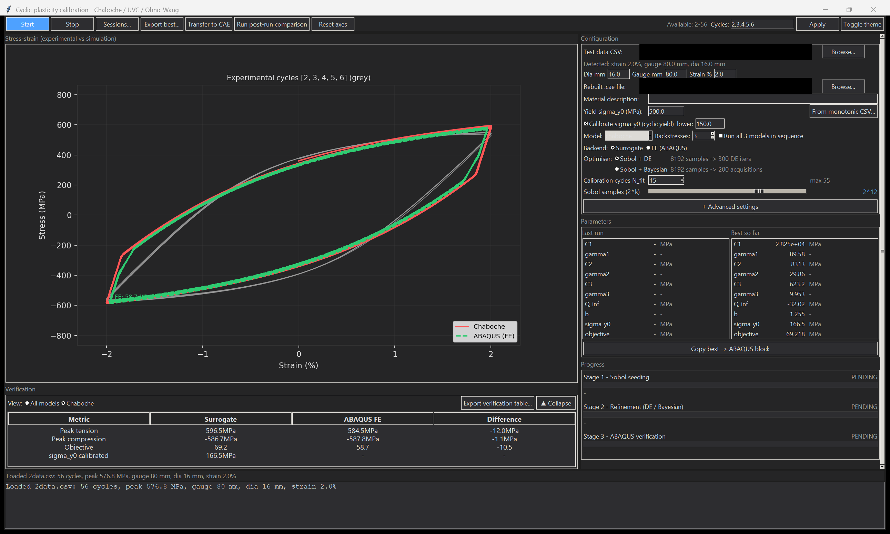
  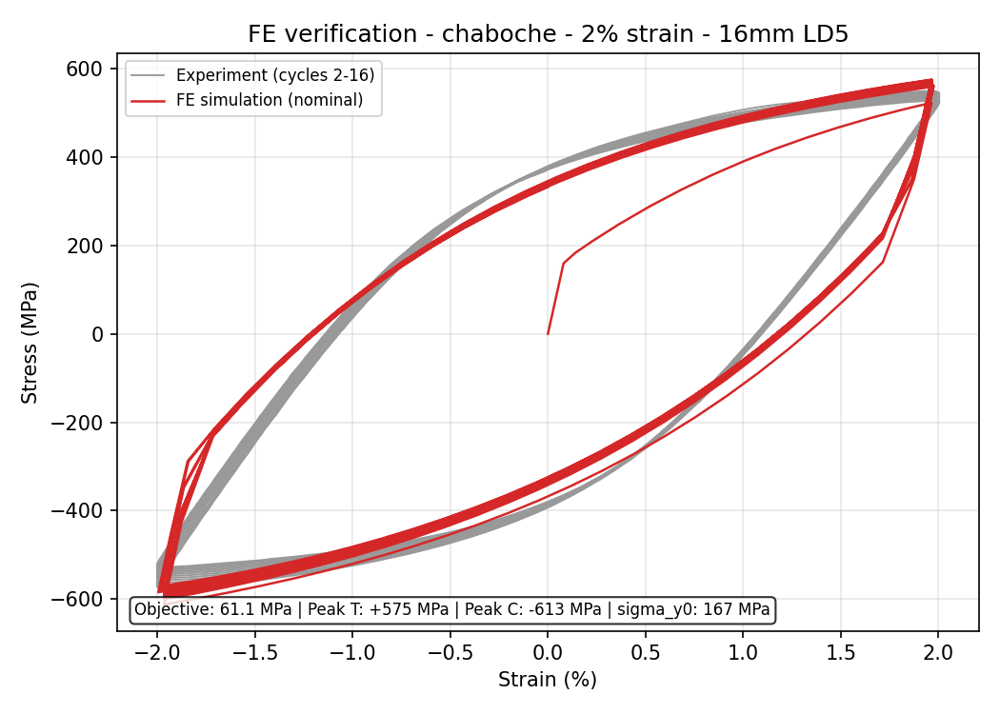
</p>

<p align="center"><em>Left: the calibration app mid-run - live stress-strain plot,
per-model verification table, and session controls. Right: the calibrated
Chaboche model transferred into a full ABAQUS coupon simulation, 2% strain
amplitude - surrogate 69.2 MPa vs FE 61.1 MPa objective. These two figures come
from the earlier setup; see "Validation and findings" below for the current
protocols.</em></p>

<p align="center">
  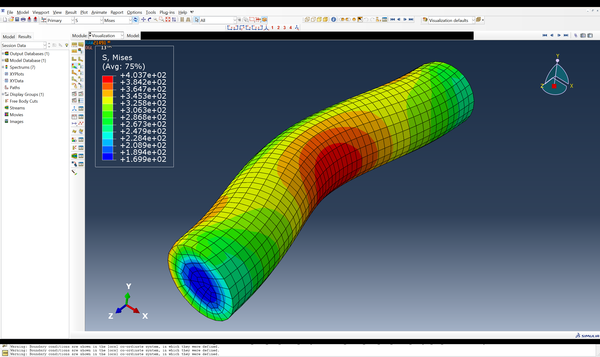
</p>

<p align="center"><em>The same job's deformed mesh in ABAQUS/CAE, contoured by
Mises stress (deformation scale exaggerated to make the shape change visible -
at true scale a 2% axial strain looks like a straight cylinder).</em></p>

## Why this exists

Constitutive-model calibration is usually reported as a single number (RMSE)
against a hand-picked parameter set. This project treats calibration as an
optimisation + verification *pipeline*:

1. Any of three published cyclic-plasticity models can be dropped in behind an
   identical interface - no optimiser or UI code changes.
2. Every model is calibrated against a fast Python surrogate, then the winning
   parameter set is **re-run inside real ABAQUS** (single-element for search-time
   checks, full 3-D coupon for final verification) and scored with the *same*
   objective - so a good surrogate fit that doesn't survive contact with a real
   finite-element solve is caught, not assumed away.
3. A physics gate rejects/repairs parameter combinations that are numerically
   fine but not physically meaningful (see below) before they ever reach ABAQUS.

## Models implemented

| Model | Reference | ABAQUS-native? | Backstresses |
|---|---|---|---|
| Chaboche combined isotropic/kinematic | Chaboche (1986), *Int. J. Plasticity* 2:149-188 | Yes (`*PLASTIC, HARDENING=COMBINED`) | 1 / 2 / 3 / 4 |
| Updated Voce-Chaboche (UVC) | Hartloper, de Castro e Sousa & Lignos (2021), *J. Struct. Eng.*, [doi:10.1061/(ASCE)ST.1943-541X.0002964](https://doi.org/10.1061/(ASCE)ST.1943-541X.0002964) | No - user material | 2 / 3 / 4 |
| Ohno-Wang model I + Voce isotropic extension | Ohno & Wang (1993), *Int. J. Plasticity* 9(3):375-390 | No - user material | 2 / 3 / 4 |

Chaboche is ABAQUS-native; UVC and Ohno-Wang are not, and this machine has no
Intel Fortran compiler (ABAQUS's official user-subroutine route). Both are
implemented as **C++ user materials compiled with MSVC** instead - the finite
element backend, the "known-hard" part of this project, is described in
[`calibration_app/umats/`](calibration_app/umats/). Every C++ port was
cross-validated against its Python surrogate to **0.0000 MPa** difference on
identical strain paths before being trusted for FE verification.

## Pipeline

```
Stage 1  Sobol space-filling search of the parameter box (replaces grid search,
         which is combinatorially infeasible past ~6 free parameters)
Stage 2  Refinement - Differential Evolution or Bayesian/TPE (Optuna)
Stage 3  ABAQUS verification of the winning candidate (single element, then
         optionally the full 3-D coupon via "Transfer to CAE")
```

Backend (Surrogate / FE) and optimiser (DE / Bayesian) are independent axes -
all four combinations are directly comparable because they share one objective:
a per-cycle weighted RMSE (`core/objective.py`), reversal regions weighted
1.5x, with the first loaded cycle excluded from scoring but retained as a
burn-in path so the model's internal state is already conditioned when scoring
starts.

## A physics gate, not just a numerical fit

A parameter set can minimise RMSE while being unphysical - three backstresses
collapsing to the same relaxation rate (an over-parameterised single
backstress in disguise), or a saturated-yield floor implying more cyclic
softening than the material can plausibly sustain. `utils/physics_gate.py`
enforces, for any model using a Chaboche-style backstress decomposition:

* **γ-separation**: `γ_k / γ_{k+1} ≥ 1.5` (Chaboche 1986 Eq. 5's own
  multi-timescale rationale; Bari & Hassan 2000) - added after a real fit on
  this dataset collapsed all three γ's to within 0.01 of each other. The
  floor started at 3 and was swept down after batch verification showed it
  binding on every session: relaxing to 1.5 cut FE-verification RMSE by
  24-34% on two independent cases with no collapse, while going all the way
  to 1 (no floor) reproduced the original collapse failure mode with a worse
  fit than 1.5 - the floor is real, it was just set tighter than the data
  supports.
* A saturated-yield floor tied to the *loaded* data's measured peak stress,
  not a hard-coded material constant - this is what keeps the whole pipeline
  grade-agnostic.

Violations are repaired by projection where possible and otherwise rejected
before the candidate is ever sent to ABAQUS.

## FE verification channels

Every full-coupon run records two independent channels, deliberately not just
one:

* **Nominal** - total reaction force on the crosshead node set divided by the
  original cross-section, against mean crosshead displacement over the gauge
  length. This is the load-cell/crosshead analogue: immune to local strain
  localisation, and the one scored against the objective.
* **Local** - axial stress/strain on the single element closest to
  mid-gauge (highlighted in the mesh figure above). Kept purely as a
  diagnostic: if it drifts from the nominal channel, that is evidence of
  barrelling or incipient buckling at high strain amplitude - a structural
  effect no single-element surrogate can represent, and something a
  surrogate-only calibration would never surface.

This dual-channel setup is what lets the pipeline tell "the constitutive
model is wrong" apart from "the specimen is deforming non-uniformly" -
two very different problems that a single RMSE number cannot distinguish.

## More FE verification results

These figures come from an earlier calibration setup (weighted objective, physics gate, handbook modulus);
see the section above for the current protocols and what the coupon check showed.

Full-coupon runs across both models, both bar geometries in the dataset, and
several strain amplitudes - all post the γ-separation floor relaxation above:

<p align="center">
  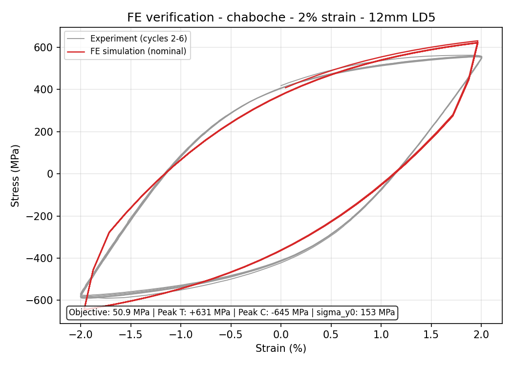
  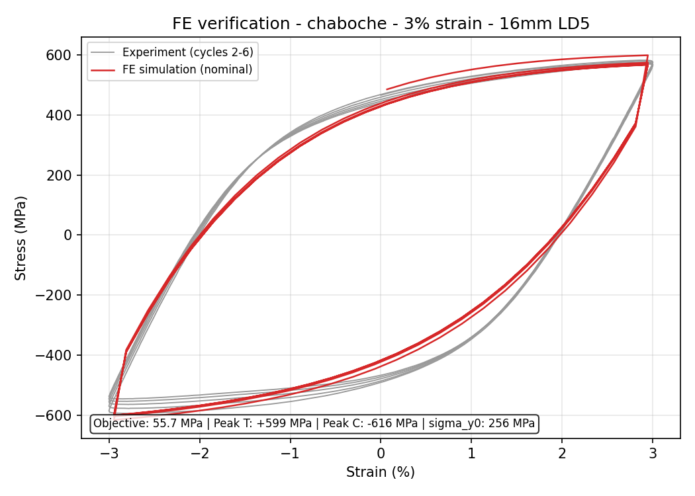
</p>
<p align="center">
  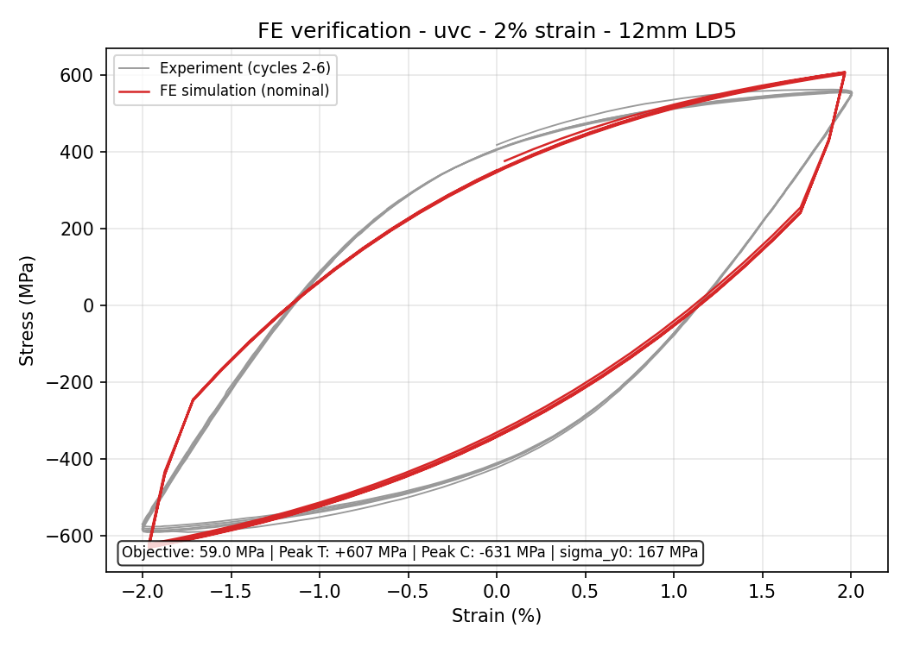
  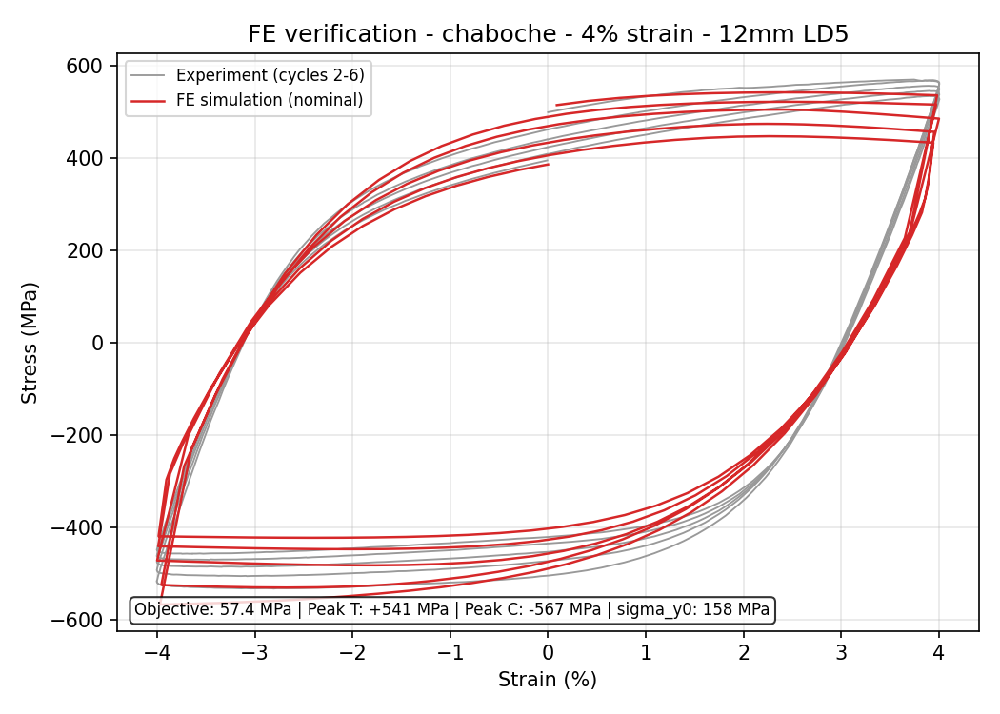
</p>

<p align="center"><em>Top left: Chaboche, 12mm/2% (surrogate 54.0 / FE 50.9
MPa). Top right: Chaboche, 16mm/3% (49.9 / 55.7 MPa). Bottom left: UVC
(Hartloper 2021 fixed-branch Newton), 12mm/2% (64.3 / 59.0 MPa). Bottom
right: Chaboche, 12mm/4% - the lowest surrogate objective of the batch
(42.7 / 57.4 MPa).</em></p>

Fit quality is strain-amplitude dependent in a physically explainable way:
2-5% strain is the pipeline's sweet spot (objectives mostly 40-95 MPa on
500-650 MPa peak stresses); 1% amplitude degrades because the elastic-range
signal is small relative to the noise floor, and 6% degrades because the
specimens approach failure (necking/crack onset visible directly in the raw
hysteresis data, not something a smooth plasticity model should be expected
to reproduce).

## Validation and findings

Results are reported against protocols written before the runs (`docs/protocols/`), with decision rules
fixed in advance and every outcome reported. The first two protocols (V1, V2) used choices that were
tuned on the rebar data and are superseded; they are kept for the record.

### Benchmark on extensometer coupon data (V5)

To separate the method from the quirks of the rebar data, the calibration was run on the open
true stress-true strain coupon database of the UVC authors (Hartloper, de Castro e Sousa and Lignos;
extensometer strain, five protocols per steel). Six steels were used: A500, A992 web and flange,
BCP325, BCR295, HYP400. The model is plain Voce-Chaboche with N = 1, 2, 3 backstresses, E and the initial
yield fitted, and the published error metric (UVC Eqs. 30-33).

<p align="center">
  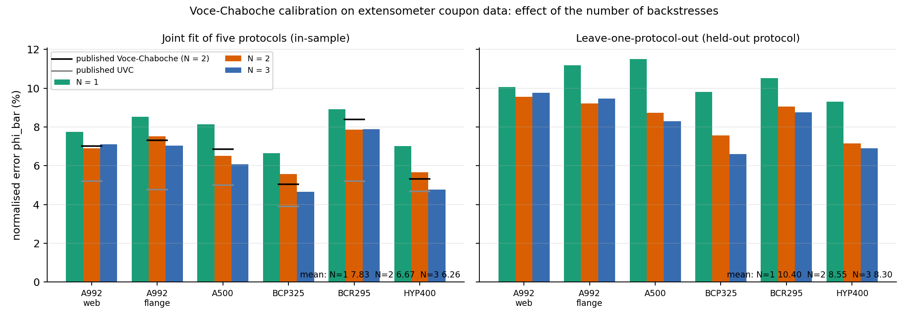
</p>

| Normalised error (%), mean of six steels | N = 1 | N = 2 | N = 3 |
|---|---|---|---|
| Joint fit of five protocols | 7.83 | 6.67 | 6.26 |
| Leave-one-protocol-out (held-out protocol) | 10.40 | 8.55 | 8.30 |

* Our N = 2 result is within 0.5 points of the published Voce-Chaboche error on all six steels
  (mean 6.67 against 6.65), which checks the objective, optimiser and integrator against the literature.
* One backstress is about 25 % worse than three, in-sample and held-out, and more than 20 % worse on
  four of six steels, so it does not meet the pre-set sufficiency rule. Two backstresses are within
  7 % (in-sample) and 3 % (held-out) of three. The UVC papers also use two.
* Parameters are poorly identified: 5, 11 and 14 of 18 fits touch a limit of the parameter box for
  N = 1, 2, 3. Only aggregates such as the total backstress are stable.

### Rebar data, point-level calibration (V3)

The Kashani et al. (2019) B500C data were calibrated with a textbook procedure: strain as recorded,
E measured from the unloading slopes of the calibration cycles, a generic parameter box, no prior, no
weighting, no physics gate, three seeds. Calibrating on cycles 2-3 and validating on cycles 4-6 of the
same test gives 43, 39 and 39 MPa (N = 1, 2, 3) against 112 MPa for a model without hardening; testing
on another strain amplitude of the same diameter gives 58, 55 and 54 MPa.

<p align="center">
  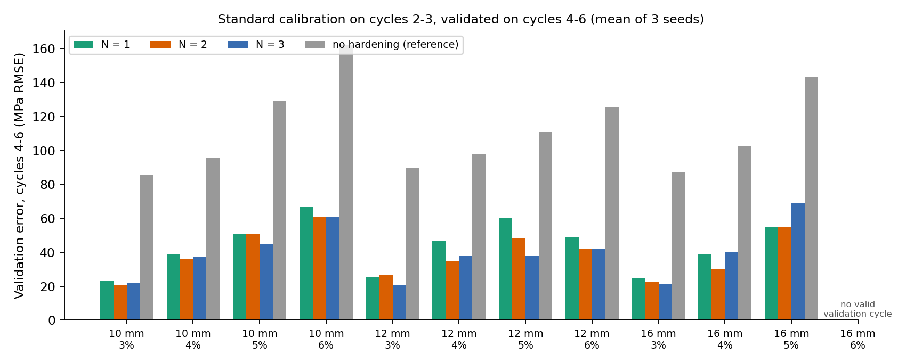
</p>
<p align="center">
  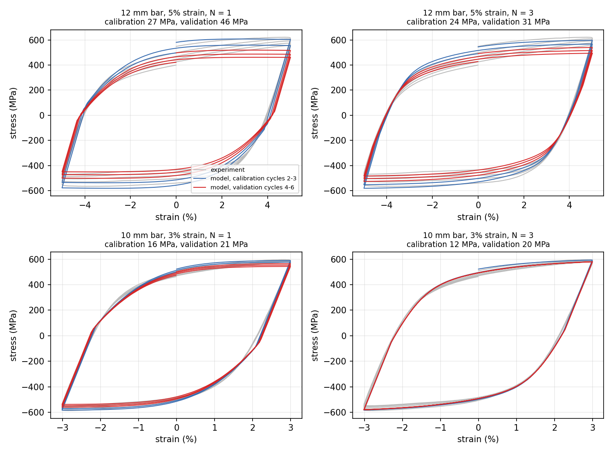
</p>

Caveats: almost every fit sits on a limit of the parameter box (mostly the softening term), 21 of 108
fits end with a negative saturated yield radius, validation on later cycles of the same test is weak,
and the fits overshoot the virgin first-cycle ramp because the first cycle was not scored.

### Full 3-D coupon (V3-F and V4-T)

The same parameters in the ABAQUS coupon give about twice the error of the point-level model (89.9
against 44.5 MPa on cycles 4-6, eight jobs), with the coupon's peak stress decaying about twice as fast
as in the tests (26 % against 14 % between cycles 2 and 6). Audits against the ODB files show that the
material card behaves like the surrogate at element level and that the extra error is structural
(strain localisation and lateral bowing). Representing the machine as a series spring with the bar at
200 GPa, which is the physically correct form for an LVDT-measured test, did not reduce the gap
(105.6 MPa), so the machine compliance is not the main cause. The cause remains open.

### Re-calibration with the benchmark lessons (V6)

The rebar data were calibrated again with the practice used in the UVC papers (protocol:
[`docs/protocols/V6_PROTOCOL.md`](docs/protocols/V6_PROTOCOL.md), frozen before any result existed). Changes
from V3: the virgin first cycle is part of the objective; data in true stress and true strain from the start of
the test; E is fitted; the isotropic term is not allowed to soften (Q >= 1e-4); the strain path is refined to
increments of at most 1e-4; the error is the UVC metric. No gate, no weighting, no prior. Cycles 1-3 are used to
calibrate and cycles 4-6 of the same test to validate. In the coupon the bar has E = 200 GPa and the machine
compliance is a spring in series, with stiffness taken from the fitted E.

| Result (mean of bars) | N = 1 | N = 2 | N = 3 |
|---|---|---|---|
| Point level, cycles 4-6 error, 12 bars, non-softening (MPa) | 78.2 | 78.8 | 79.1 |
| Point level, softening allowed (MPa) | 56.3 | 50.5 | 49.8 |
| Another strain amplitude of the same diameter, non-softening (MPa) | 115.6 | 126.3 | 128.6 |
| ABAQUS coupon, cycles 4-6 error, 6 bars, non-softening (MPa) | 53.9 | 44.6 | 39.1 |
| ABAQUS coupon, 4 bars, softening allowed (MPa) | 233.1 | 113.8 | 139.4 |

An elastic-perfectly-plastic model with E and yield fitted on the same window gives 87.3 MPa at the point level.
The earlier coupon runs with the V3 parameters gave 89.9 MPa (V3-F) and 105.6 MPa (V4-T).

<p align="center">
  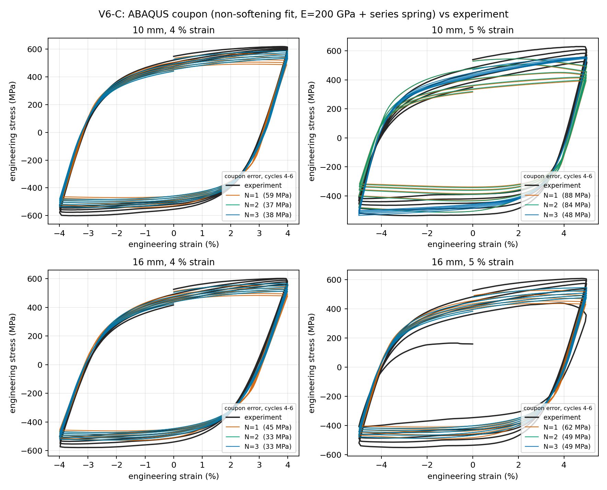
</p>
<p align="center">
  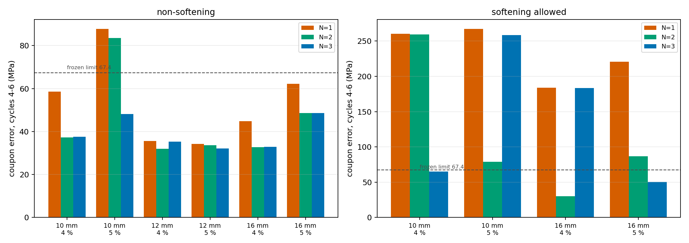
</p>

What the results say:

* The coupon check passes the pre-set criteria for every N (mean error at most 67.4 MPa, tension-peak decay gap
  below 12.9 points), and the coupon now agrees with the experiment far better than with the V3 parameters. The
  decay gap is 6.3, 6.5 and 7.2 points against 12.9 (V3-F) and 16.2 (V4-T).
* The point-level success rule was not met: the non-softening N = 2 error is 78.8 MPa against a limit of 48.6 MPa.
  The non-softening constraint costs accuracy at the point level, and the three N give the same error there
  because the constraint dominates.
* One backstress is not sufficient by the pre-set rule in the coupon: its error is 1.38 times that of three
  backstresses and more than 20 % worse on 4 of 6 bars. On the 12 mm bars it is as good as three (35.6 against
  35.3 and 34.3 against 32.1 MPa), on 16 mm it is 12 and 13 MPa worse, on 10 mm 21 and 40 MPa worse. Two
  backstresses narrowly miss the rule (ratio 1.14).
* Fits that allow softening are better at the point level but unusable in the coupon: the yield stress falls
  towards zero and the errors are 114-233 MPa.
* Parameters are poorly identified. The isotropic term sits on a limit of its box in nearly all fits, so it is
  effectively inactive, and most fits touch a limit of the box somewhere.

Caveats: validation uses later cycles of the same test; carrying the 3 % bar to other amplitudes gives 116-129 MPa;
the coupon covers 6 bars at seed 1 (the 3 % and 6 % bars were not run); the success criteria were set by us before
the runs, not taken from a standard; the coupon and point-level errors use different metrics and are not directly
comparable. Two input-file bugs in the 12 mm coupon runs were found and fixed during the work (a hard-coded node-set
name, then a node list read as a range); the failed and invalid records are archived and logged as deviations in the
protocol, and only the final runs are reported.

### What is established and what is not

* Established: the calibration method reproduces published fit errors on extensometer data; two backstresses
  are the minimum there, and one backstress costs about 25 % more error; on the rebar coupon, one backstress
  costs about 38 % more than three and two about 14 % more; the rebar data are LVDT-measured (apparent modulus
  54-74 GPa against about 200 GPa for the bar), never stabilise, and sit at the buckling threshold.
* Not established: validation of the rebar calibration on independent data; behaviour on the target scrap rebar;
  any result from extensometer-measured rebar LCF data (none was available). The rebar results are exploratory.

### Superseded exploratory work

Calibrating from the monotonic ramp of each test alone, with a tuned prior on the cyclic yield stress,
was explored first (`scripts/run_mono_to_loops.py`, `scripts/run_mono_ablation.py`). Under a
pre-registered protocol (V2) it was no better than a no-information model on later cycles (129-135
against 133 MPa), and the earlier claim that one backstress matches three on that route does not hold
under a cleaner protocol.

## Repository layout

```
calibration_app/
  core/
    surrogate.py          CyclicPlasticityModel base + N-backstress Chaboche
    uvc_model.py           Updated Voce-Chaboche surrogate (fixed-branch Newton)
    ohno_wang_model.py     Ohno-Wang I + Voce isotropic, substepped integrator
    objective.py           shared scorer (surrogate + FE), engineering strain
    abaqus_runner.py       FE-in-the-loop backend (single-element jobs)
    cae_transfer.py        pushes a calibrated fit into a full 3-D ABAQUS coupon
    search.py              Sobol seeding + Differential Evolution + Optuna
    data_loader.py         strain autodetection, gauge-length derivation
    pipeline.py            run orchestration
  utils/physics_gate.py    grade-agnostic physical-validity gate
  session/                 crash-safe checkpointing, session browser
  ui/                      Tkinter GUI (live plot, verification table, themes)
  umats/                   C++ user materials (UVC, Ohno-Wang) + MIT-licensed
                           Fortran reference implementations
docs/
  literature-review.md     model-selection literature survey with confidence
                           ratings and citations (Chaboche/Ohno-Wang/UVC/etc.)
  ohno-wang-model-reference.md  full equation reference used to derive the
                           surrogate and UMAT integrators
  kashani-2019-dataset.md  validation-dataset methodology summary
  results-table.md         calibrated parameters + active-constraint audit
                           for the sessions behind the figures above
scripts/
  run_calibration_headless.py  reproducible GUI-free re-runs
  run_full_workflow.py         CSV to calibrated fit to ABAQUS coupon, unattended
  v5_study.py                  benchmark on extensometer coupon data (set UVC_DATA)
  v3_study.py, v2_study.py     rebar calibration and loaders
  v3_fe.py, v4_spring_test.py  full-coupon ABAQUS runs, with and without the series spring
  v6_study.py, v6_fe.py        re-calibration with the benchmark practice, and its coupon runs
  run_mono_to_loops.py         monotonic-ramp route (superseded, see above)
  run_mono_ablation.py         its backstress ablation driver (superseded)
  export_paper_table.py        parameter/results table generator
  plot_fe_comparison.py        standalone ABAQUS-Python post-run comparison
figures/                   app screenshot, mesh diagram, FE-verification, benchmark and rebar plots
```

## Running it

```bash
pip install -r requirements.txt
python -m calibration_app.main
```

The GUI backend needs `tkinter` (standard on most Python distributions). The
FE-in-the-loop backend and "Transfer to CAE" additionally require a licensed
ABAQUS 2024 install and, for the UVC / Ohno-Wang user materials, an MSVC C++
toolchain - see `calibration_app/umats/` for the compile chain.

## What isn't in this repository, and why

* **`input_data/`** - the Kashani et al. (2019) Bristol dataset is openly
  available at its own DOI (below); it isn't re-hosted here.
* **`calibration_sessions/`** - full run history (ABAQUS `.odb`/`.inp` files,
  per-evaluation logs) is gigabytes per session and specific to a local
  machine; `figures/` and `docs/results-table.md` are the curated summary.
* **`FATIGUE.cae` / `FATIGUE_rebuilt.cae`** - proprietary-format ABAQUS binaries
  with no value outside a licensed ABAQUS install; `cae_transfer.py` documents
  and regenerates everything they contain.

## Citations

* Kashani, M.M., Cai, S., Davis, S.A. & Vardanega, P.J. (2019). "Influence of
  Bar Diameter on Low-Cycle Fatigue Degradation of Reinforcing Bars." *J. Mater.
  Civ. Eng.* 31(4). [doi:10.1061/(ASCE)MT.1943-5533.0002637](https://doi.org/10.1061/(ASCE)MT.1943-5533.0002637)
  - dataset: [doi:10.5523/bris.1kz5015zjoel92ueb97kwxd4ps](https://doi.org/10.5523/bris.1kz5015zjoel92ueb97kwxd4ps)
* Chaboche, J.L. (1986). "Time-independent constitutive theories for cyclic
  plasticity." *Int. J. Plasticity* 2(2):149-188.
* Ohno, N. & Wang, J.D. (1993). "Kinematic hardening rules with critical state
  of dynamic recovery, Part I." *Int. J. Plasticity* 9(3):375-390.
* Hartloper, A., de Castro e Sousa, A. & Lignos, D.G. (2021). "Constitutive
  Modeling of Structural Steels: Nonlinear Isotropic/Kinematic Hardening
  Material Model and Its Calibration." *J. Struct. Eng.* 147(4).
  [doi:10.1061/(ASCE)ST.1943-541X.0002964](https://doi.org/10.1061/(ASCE)ST.1943-541X.0002964)
  - UMAT reference: [github.com/ahartloper/UVC_MatMod](https://github.com/ahartloper/UVC_MatMod)
* Bari, S. & Hassan, T. (2000). "Anatomy of coupled constitutive models for
  ratcheting simulation." *Int. J. Plasticity* 16(3-4):381-409.

Full literature survey with per-claim confidence ratings: `docs/literature-review.md`.

## License

MIT - see `LICENSE`. The UVC user-material files under `calibration_app/umats/`
carry their own MIT attribution to the original authors (see `LICENSE` and
`calibration_app/umats/UVC_LICENSE_MIT.txt`).
